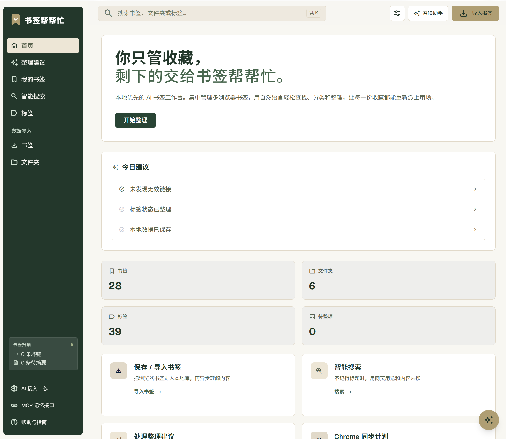
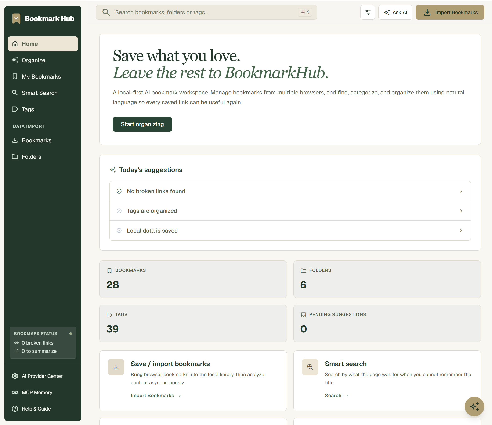
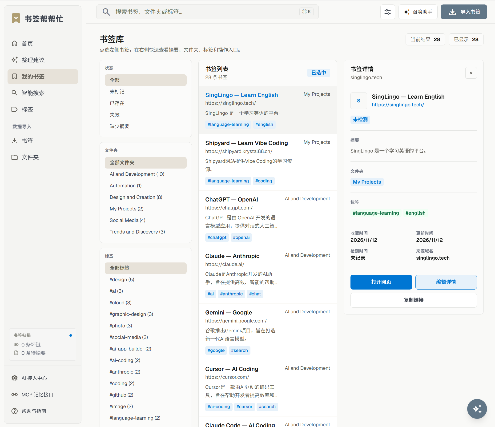
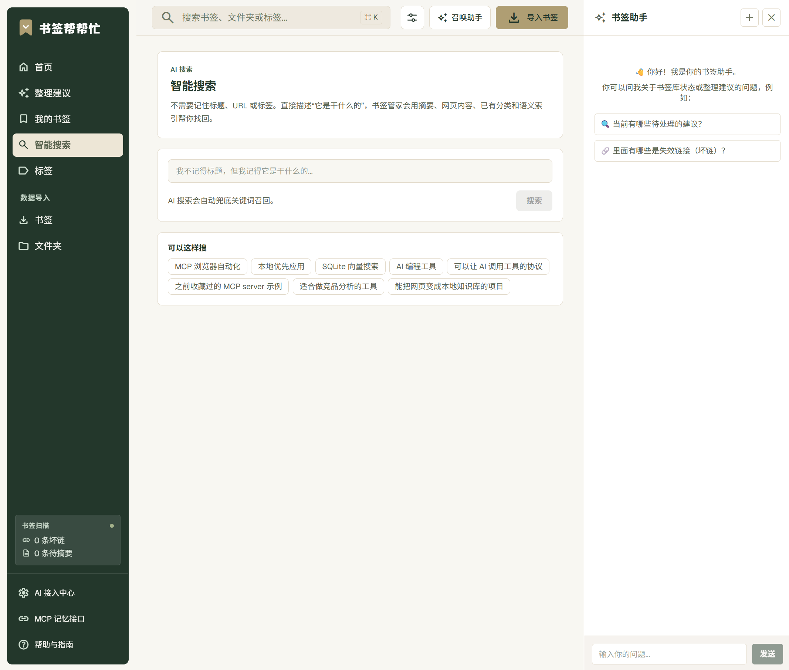
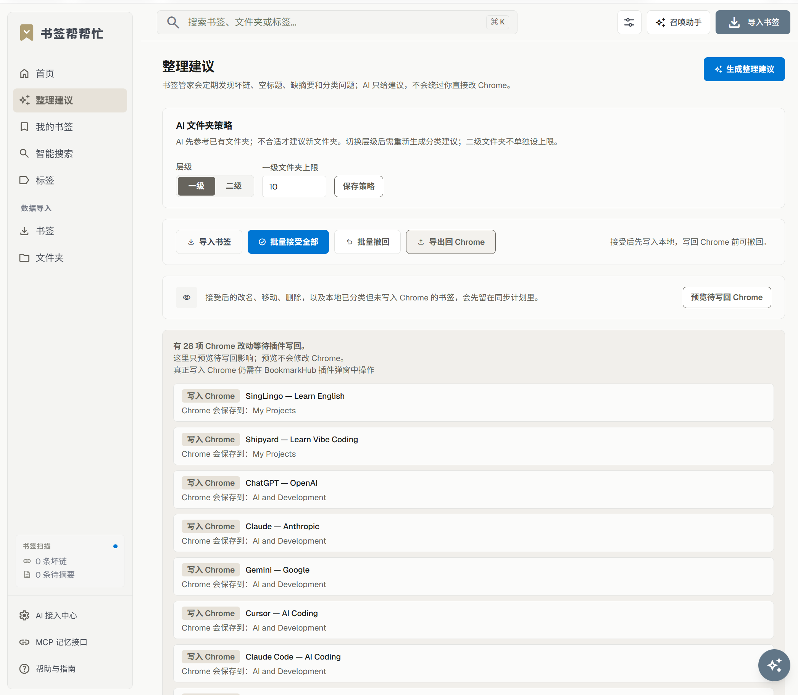
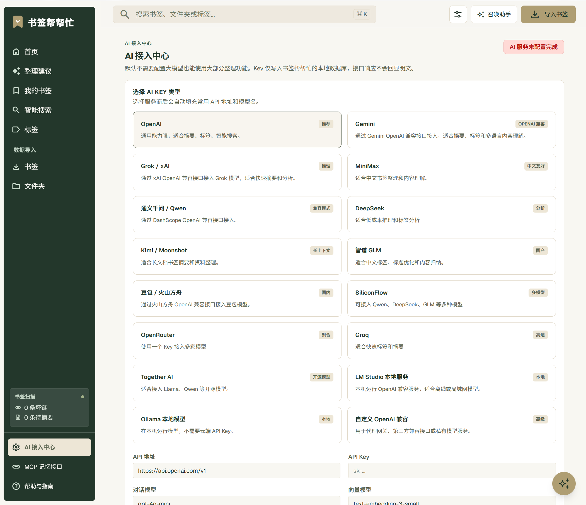
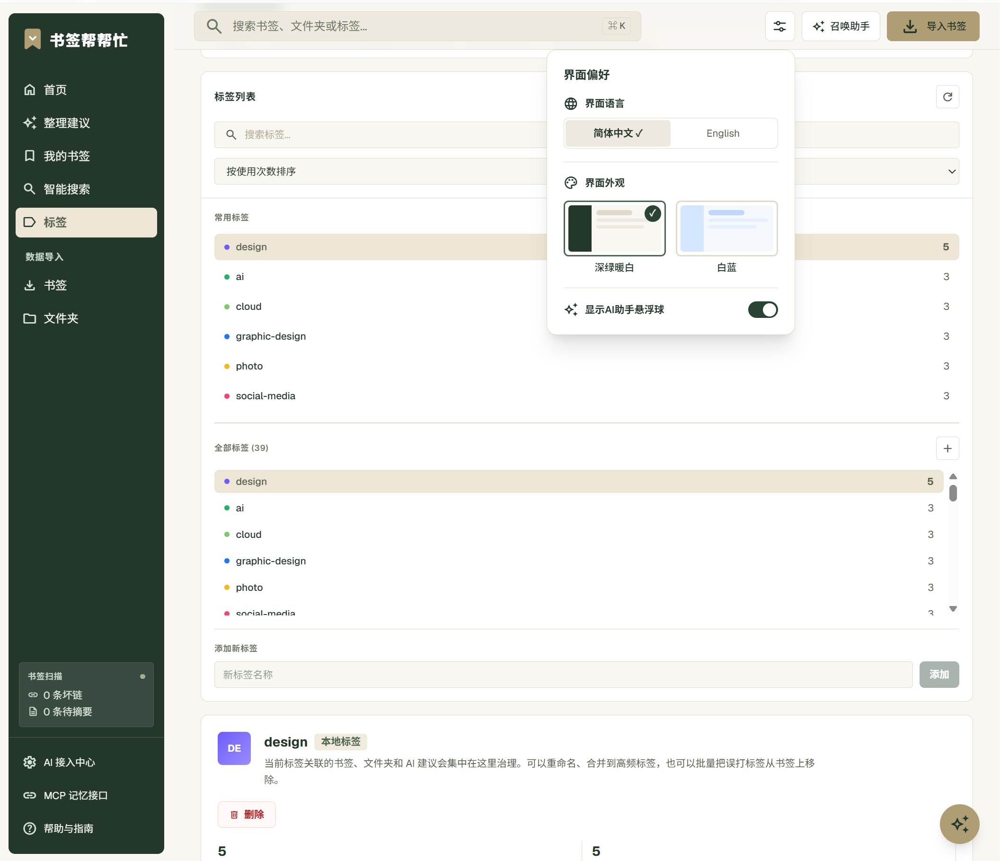
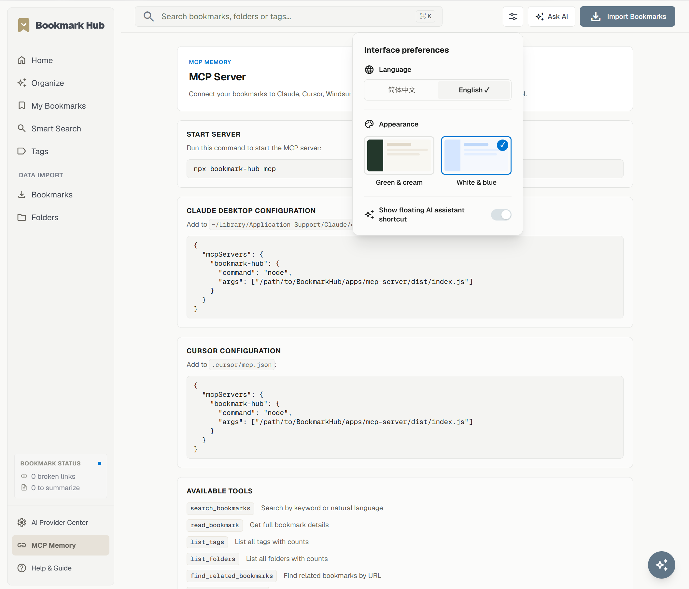

<div align="center">

# BookmarkHub

**Save what you love. Let BookmarkHub's AI assistant help with the rest.**

BookmarkHub is a local-first AI bookmark workspace. Bring together bookmarks from different browsers, find them using natural language, and organize them with AI. Your data is stored locally by default. Configure your preferred model and connect AI tools such as Claude and Cursor through MCP.

<a href="./LICENSE"></a>


[简体中文](./README.md) · [English](./README.en.md)

[Product preview](#product-preview) · [Key features](#key-features) · [Quick start](#quick-start) · [AI and MCP](#ai-and-mcp)

</div>

## About BookmarkHub

Import your Chrome bookmarks into a local library where you can search, manage folders and tags, review AI-assisted organization suggestions, and sync supported changes back to your browser. You can configure a model to analyze your collection and connect compatible AI clients through MCP.

## Product preview

### Home

<table>
  <tr>
    <td align="center"><br>Chinese</td>
    <td align="center"><br>English</td>
  </tr>
</table>

### Bookmark library

Browse by folder, tag, or status and view summaries and details for each bookmark.



### Smart search and bookmark assistant

Find saved pages using keywords or natural language, and ask the assistant questions about your library.



### Organize and sync

Review suggestions and preview changes before syncing them to Chrome.



### AI Provider Center

Choose an AI service to generate summaries, tags, and classification suggestions.



### Interface preferences

Use the preferences menu in the top bar to switch between Chinese and English, choose either color theme, or enable the optional floating AI assistant shortcut. The interface uses your browser's preferred language and remembers your manual selection.



### MCP and interface preferences



## Use cases

**Organize a growing collection**

Import Chrome bookmarks, then review vague titles, links marked as broken, folders, and tags. BookmarkHub offers rule-based and optional AI suggestions that you can review individually or accept in batches where supported.

**Find a page you only vaguely remember**

Use keyword search without a model. With a configured model and vector index, you can also search by meaning.

**Make new bookmarks easier to find**

Save the current page with the Chrome extension. When an AI provider is configured, BookmarkHub can offer classification choices based on your existing folders.

**Use bookmarks in an AI workflow**

From an MCP-compatible client such as Claude or Cursor, search bookmarks, read their details, or save a new link.

**Describe an organizing task**

Ask the assistant to find relevant bookmarks and suggest a folder. Each search supplies up to 12 results, so results may be incomplete. Suggestions are prepared for your review.

## Key features

### 1. Manage bookmarks using natural language

With an AI provider configured, ask the assistant about saved bookmarks, library statistics, and pending suggestions. You can also request folder move suggestions. Each search uses up to 12 bookmarks, and you decide whether to accept the suggestions.

### 2. Organize with AI assistance

BookmarkHub identifies items that need attention and suggests improvements to titles, folders, and tags. A configured AI provider can also generate summaries, tags, and classification suggestions. Folder depth and top-level folder limits can guide organization.

You can create, rename, delete, and merge tags, and review AI suggestions. Some accepted local changes can be undone, but this does not guarantee reversal of changes already made in Chrome.

### 3. Find and reuse saved pages

Search can use titles, URLs, descriptions, tags, summaries, and indexed content. Keyword search uses SQLite FTS5 without AI. Optional memory search uses available embeddings and falls back to keyword results if vectors are unavailable or the search fails.

AI understanding depends on successful content fetching and indexing and on the configured model. BookmarkHub does not currently archive complete web pages or guarantee access to all page content.

### 4. Local storage and user confirmation

Your library is stored in a local SQLite database by default. AI providers are configured by the user, and the default Mock mode does not call an external model.

Review suggestions in the dashboard. Syncing supported changes to the original Chrome bookmarks requires Chrome IDs and confirmation in the extension. Content fetching, broken-link checks, cloud AI providers, and cloud AI clients may make network requests or transmit data. See [Local data and privacy](#local-data-and-privacy).

### 5. Connect other AI tools through MCP

The built-in MCP server provides compatible clients with tools to search and read local bookmarks, list folders and tags, save bookmarks, and retrieve statistics.

MCP serves external AI clients. The built-in assistant sidebar is a separate interface and does not automatically share MCP tool permissions. Some MCP tools use simplified implementations, as described in [AI and MCP](#ai-and-mcp).

## Quick start

Run BookmarkHub from source. Load the Chrome extension manually if you want to use it.

### Requirements

- Node.js 22 or later and npm.
- Google Chrome for direct Chrome bookmark import and sync-back.
- An optional model service for AI summaries, classification, chat, and vector search. Basic import and keyword search do not require a model.

### Windows

Double-click `start.bat` in the project root. The script checks the environment, installs missing dependencies, builds the production version, and starts the local web service at `http://localhost:4399`. If the service is already running, it opens the dashboard.

Install Node.js before running the script. The Chrome extension still needs to be loaded manually.

### macOS / Linux

Run this from the project root:

```bash
bash start.sh
```

The script checks dependencies, builds the required packages, and starts the dashboard in development mode. Keep the terminal open while using the app. The Windows launcher uses production mode.

### Run from source

```bash
npm install
npm run build:packages
npm run dev
```

Open `http://localhost:4399`.

### Connect the Chrome extension

1. Keep the local BookmarkHub service running.
2. Open `chrome://extensions` and enable **Developer mode**.
3. Select **Load unpacked** and choose `apps/chrome-extension` from the project.
4. Open the extension to import bookmarks or save the current page.

If you plan to sync changes back to Chrome, import through the extension so Chrome bookmark IDs are retained. Importing `bookmarks.html` alone does not establish that ID association.

### Try the sample bookmarks

Use a separate data directory to try the CLI with sample bookmarks:

```bash
BOOKMARK_HUB_HOME=/tmp/bookmark-hub-demo npm run cli -- init
BOOKMARK_HUB_HOME=/tmp/bookmark-hub-demo npm run cli -- import examples/bookmarks.html
BOOKMARK_HUB_HOME=/tmp/bookmark-hub-demo npm run cli -- search "Claude"
BOOKMARK_HUB_HOME=/tmp/bookmark-hub-demo npm run cli -- rescue
```

These commands use a separate SQLite directory. Syncing changes to Chrome requires confirmation through the extension.

## Bookmark workflow

### 1. Import and index

- **Web dashboard:** Import a browser-exported bookmark HTML file.
- **Chrome extension:** Import the browser bookmark tree and retain Chrome IDs for sync-back.
- **CLI:** Import an HTML file.

Import creates or updates the local full-text index. Optional deeper indexing can fetch page metadata or content and generate summaries, tags, or embeddings with the configured provider. Fetching contacts the target websites, and some pages may not be accessible.

### 2. Search and manage

Browse by folder, tag, and status or use keyword search. With a configured model and generated vectors, you can also use memory search. Keyword results remain available without vectors.

### 3. Review organization suggestions

Open `http://localhost:4399/rescue` to review suggestions for titles, folders, tags, and bookmarks marked as broken. Some suggestions require an AI provider.

Accept or dismiss suggestions. Accepted changes are first applied to the local library, while supported Chrome changes enter the sync-back workflow. Duplicate detection is available, but the normal review list and duplicate sync-back flow have limitations and do not provide complete automatic duplicate merging.

### 4. Confirm sync-back to Chrome

```text
Review suggestions in the dashboard
        ↓
Accept applicable suggestions to prepare sync operations
        ↓
Open the Chrome extension and review the sync plan
        ↓
Confirm the changes in the extension
```

Supported operations include renaming, moving, some removals, and adding bookmarks. Availability depends on bookmark ID associations and operation type. The Web API does not directly modify Chrome bookmarks. If Chrome Sync is enabled, Chrome may sync browser changes to other devices.

### 5. AI conversation

The sidebar searches relevant bookmarks and can send the question, conversation history, and related content to the configured model. General questions can also include library statistics and up to 200 pending suggestions. For folder organization, the assistant can prepare move suggestions for review using up to 12 search results. It does not directly modify Chrome bookmarks.

## AI and MCP

### AI Provider Center

Select an AI provider at `http://localhost:4399/settings`. A provider is optional for basic import, FTS keyword search, and rule-based checks.

| Provider | Typical configuration | Description |
| --- | --- | --- |
| Mock (default) | No key required | Does not call external models or provide generative chat, AI summaries, or embeddings |
| Ollama-compatible | Endpoint and model name | Connects to a model service, including a locally hosted service |
| Local OpenAI-compatible, such as LM Studio | Local base URL and model name | Uses a compatible local service; capabilities depend on the model and service |
| Cloud OpenAI-compatible | Base URL, API key, and model name | Enables optional AI features; relevant request data may be sent to the configured provider |

Common endpoint examples depend on the provider's current documentation and your account configuration:

```text
OpenAI:     https://api.openai.com/v1
Qwen:       https://dashscope.aliyuncs.com/compatible-mode/v1
DeepSeek:   https://api.deepseek.com/v1
Groq:       https://api.groq.com/openai/v1
Ollama:     http://localhost:11434
LM Studio:  http://localhost:1234/v1
```

Chat models do not necessarily support embeddings. Configure a compatible embedding model when you need vector search.

### MCP server

Build the stdio MCP server:

```bash
npm run build:packages
```

Configure it in an MCP-compatible client. Replace the path in this Claude Desktop-style example with the absolute path on your machine:

```json
{
  "mcpServers": {
    "bookmark-hub": {
      "command": "node",
      "args": ["/absolute/path/to/BookmarkHub/apps/mcp-server/dist/index.js"]
    }
  }
}
```

| Tool | Current behavior |
| --- | --- |
| `search_bookmarks` | Search local bookmarks, optionally using query rewriting or vector search depending on configuration |
| `read_bookmark` | Read details of one stored bookmark |
| `list_tags` | List tags and counts |
| `list_folders` | List folders and counts |
| `find_related_bookmarks` | Search related bookmarks using URL path keywords; not vector-based recommendations |
| `summarize_collection` | Return entries and a tag overview for a collection; not a model-generated full summary |
| `save_bookmark` | Save a new bookmark directly to the local database |
| `run_bookmark_rescue` | Generate rule-based suggestions; the `full` parameter does not perform or apply full AI organization |
| `get_bookmark_stats` | Retrieve library statistics |

How returned data is used or sent to a cloud model depends on the client and model you configure. MCP includes a local write tool, so review the client's tool permission prompts.

## Local data and privacy

BookmarkHub is local-first, with different data boundaries for each feature.

| Feature | Data and operation boundary |
| --- | --- |
| Local library | Stored by default at `~/.bookmark-hub/bookmark-hub.sqlite`; override the directory with `BOOKMARK_HUB_HOME` |
| Mock mode | Does not call external AI models; basic local management and FTS search remain available |
| Cloud AI providers | Titles, URLs, page snippets, searches, or chat context may be sent to the configured provider when relevant features are used |
| Page fetching and broken-link checks | Make network requests to target URLs, regardless of the default setting for external AI calls |
| Bookmark assistant | May send questions, conversation history, relevant bookmarks, statistics, or pending suggestions to the configured model |
| Chrome sync-back | Requires extension confirmation after local suggestions are accepted; Chrome Sync may propagate browser changes to other devices |
| MCP clients | Configured by the user; returned bookmark data may enter the connected AI client's context |

**Security:** The local Web API is intended for `localhost:4399` and does not currently provide reliable, unified account authentication or API token checks. Do not expose it directly to the internet or a local network without additional protection.

The local data-clearing endpoint deletes bookmarks, tags, folders, suggestions, embeddings, and indexes, but does not clear every setting or directly delete Chrome bookmarks. Back up the database before important operations. Some settings may not cover every network call, so do not rely solely on a local-mode label to determine whether a request is made.

### Chrome extension permissions

| Permission | Purpose |
| --- | --- |
| `bookmarks` | Read Chrome bookmarks and perform supported changes after confirmation |
| `activeTab` | Read the current page title and URL when saving it |
| `storage` | Store local extension state |
| `alarms` | Support local reminders or status refreshes |
| `http://localhost:4399/*` | Communicate with the local BookmarkHub Web API |

## Developer reference

### CLI

Build with `npm run build:packages`, then use:

```bash
npm run cli -- init
npm run cli -- stats
npm run cli -- doctor
npm run cli -- import ./bookmarks.html
npm run cli -- search "mcp browser automation"
npm run cli -- rescue
npm run cli -- index --limit 100
npm run cli -- export ./bookmark-hub-export.json
```

In Mock mode, `index` does not call cloud AI. If content fetching is enabled, it may still contact target websites.

### Project layout

```text
bookmark-hub/
  apps/
    web/               Local Next.js dashboard and API
    cli/               Command-line interface
    mcp-server/        MCP stdio server
    chrome-extension/  Chrome extension for import, saving, and sync-back
  packages/
    shared/            Shared types and utilities
    db/                SQLite data access
    core/              Import, search, and organization logic
    ai/                AI provider adapters
    indexer/           FTS, summaries, tags, and embeddings
```

### Development and checks

```bash
npm install
npm run build:packages
npm run build
npm run typecheck
npm run lint
```

The repository does not have a unified `npm test` script. A successful build does not verify every workflow. Before submitting changes, check startup, import, indexing, review, sync-back, and MCP behavior.

Use a separate directory for test data:

```bash
BOOKMARK_HUB_HOME=/tmp/bookmark-hub-test npm run cli -- init
```

## Project and open-source information

### Current features

BookmarkHub includes a local library, Chrome and HTML import, keyword and optional semantic search, organization suggestions and review, optional AI indexing, Chrome extension sync-back, an MCP server, a CLI, and a bookmark assistant that can search and prepare folder suggestions.

### License and acknowledgments

BookmarkHub is based on the open-source [SiftMarks](https://github.com/Lling0000/SiftMarks) project. Thank you to the original author and contributors for their work.

This project is available under the MIT license and retains the original copyright notice. See [LICENSE](./LICENSE) for details.
