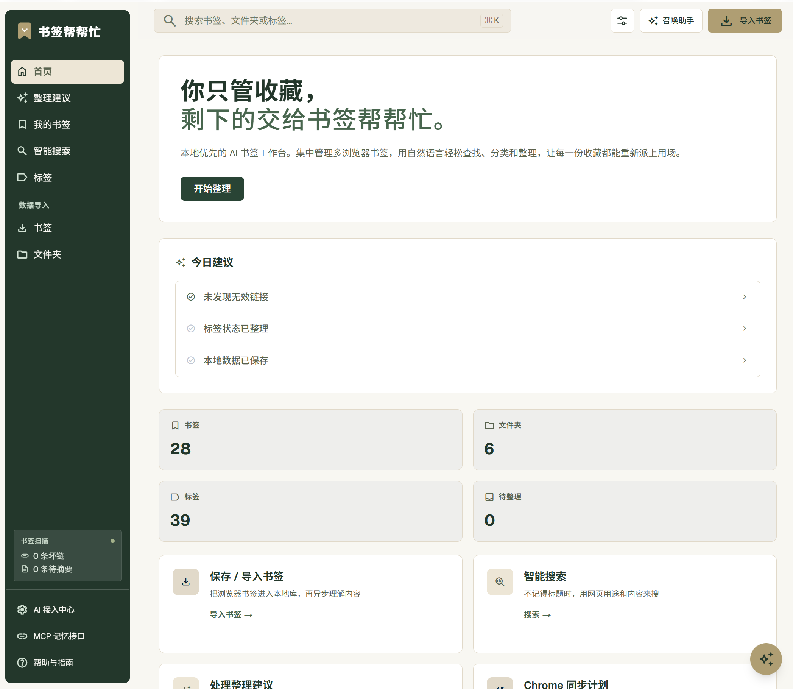
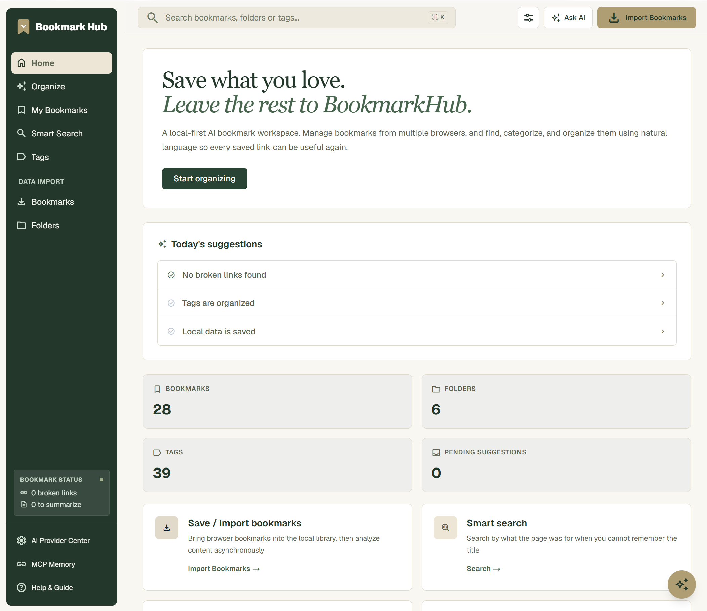
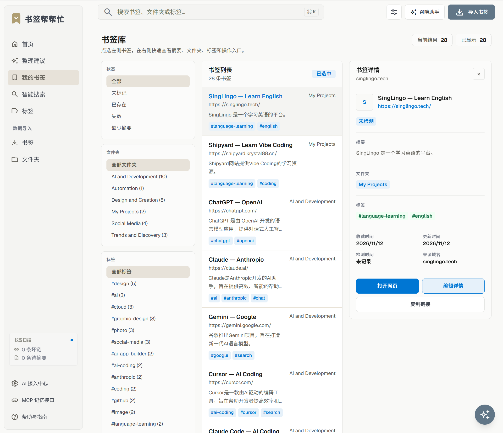
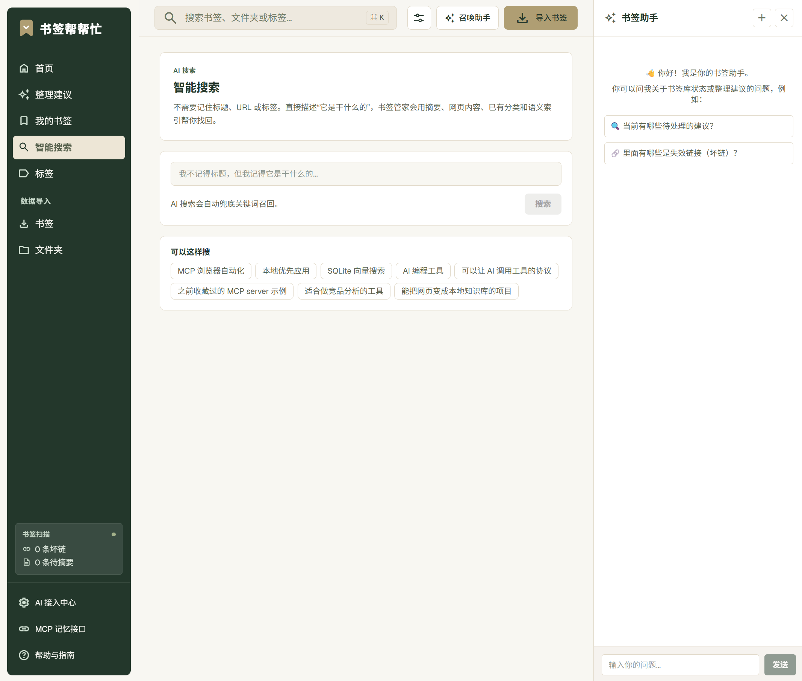
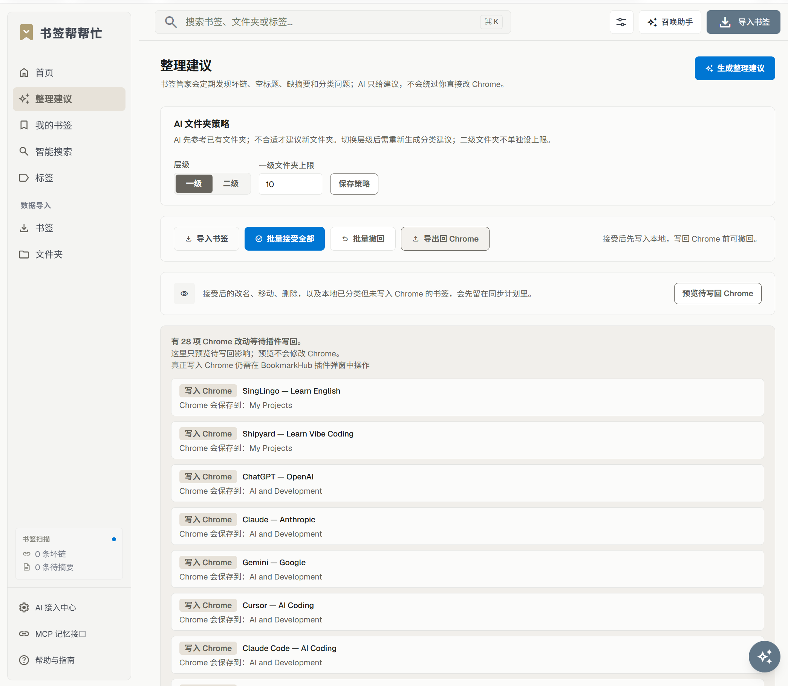
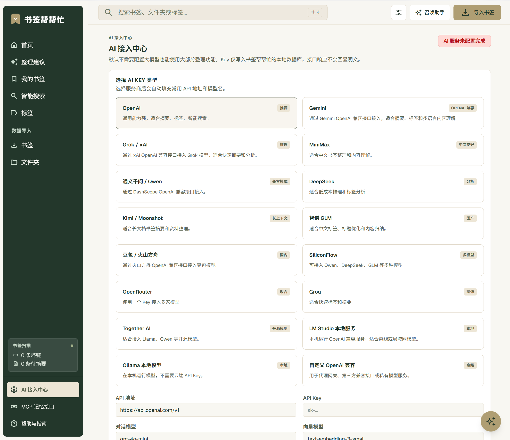
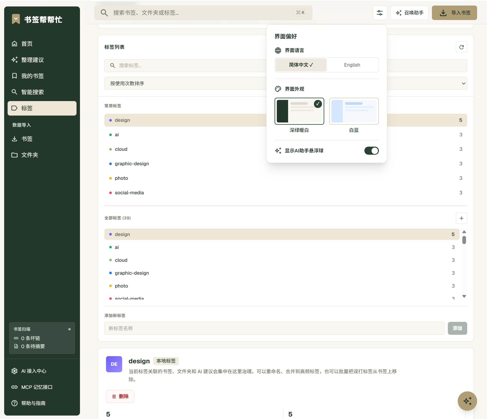
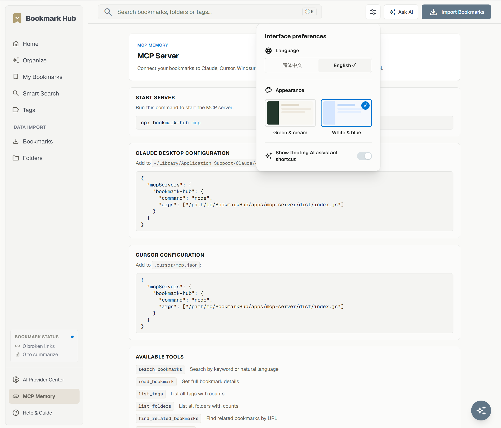

<div align="center">

# BookmarkHub

**你只管收藏，其他的都交给AI书签助手。**

BookmarkHub 书签帮帮忙 是一款本地优先的 AI 书签工作台。集中管理不同浏览器保存的书签链接，通过自然语言查找资料、智能分类和整理书签。数据默认保存在本地。支持自由配置模型，还可以通过 MCP 连接 Claude、Cursor 等 AI 工具。

<a href="./LICENSE"></a>


[简体中文](./README.md) · [English](./README.en.md)

[产品预览](#产品预览) · [核心优势](#核心优势) · [快速开始](#快速开始) · [AI-与-mcp-集成](#ai-与-mcp-集成)

</div>

## 产品介绍

从 Chrome 书签导入开始，BookmarkHub 将收藏内容集中保存在本地书签库中，并提供搜索、AI 辅助整理及审查后的浏览器写回。你可以直接管理文件夹和标签，也可以自行配置模型，让 AI 帮你分析已有收藏。通过 MCP，收藏还可以被兼容的外部 AI 客户端调用。让你的收藏不再吃灰，曾经的书签在更多场景中派上用场。

## 产品预览

### 首页

<table>
  <tr>
    <td align="center"><br>中文首页</td>
    <td align="center"><br>英文首页</td>
  </tr>
</table>

### 书签库

按文件夹、标签和状态浏览收藏，查看每条书签的摘要和详情。



### 智能搜索与书签助手

用关键词或自然语言查找收藏，也可以打开书签助手询问书签库相关问题。



### 整理与同步

查看整理建议，并在同步到 Chrome 前预览待写回的内容。



### AI 接入中心

选择适合自己的 AI 服务，为书签生成摘要、标签和分类建议。



### 个性化界面

在顶部的「界面偏好」中，可以切换中英文和两种配色，也可以开启默认关闭的 AI 助手悬浮球。界面会根据浏览器的首选语言选择中文或英文，并记住你手动选择的语言。



### MCP 与界面偏好



## 使用场景

收藏的网页越多，最费时间的往往不是「保存」，而是之后怎样找到、整理和使用它们。

**整理积累多年的收藏**

导入 Chrome 书签后，检查模糊标题、已有失效状态、分类和标签问题。BookmarkHub 提供规则及可选 AI 整理建议，你可以逐条审查，或在支持的范围内批量接受。

**找回只记得大概内容的网页**

你可能记得收藏过一篇关于视频自动化的文章，却忘了标题。先使用无需模型的关键词搜索；配置可用的模型并建立向量索引后，还可以尝试按内容含义检索。

**让新的收藏更容易归类**

使用 Chrome 扩展保存当前网页时，BookmarkHub 可以将它纳入本地书签库。配置真实 AI Provider 后，还可以根据已有文件夹结构提供分类选择，减少之后重新整理的工作。

**在自己的 AI 工作流中调用收藏**

在 Claude、Cursor 等支持 MCP 的客户端中，直接搜索 BookmarkHub 里的书签、读取收藏详情或保存新链接，不必为了找一个旧链接切换回书签管理页面。

**用一句话交代整理任务**

例如：「找出我收藏的 AI 视频工具，建议放进一个合适的文件夹。」书签助手会尝试检索相关书签并生成待审建议；当前一次最多参考 12 条检索结果，结果不保证完整。

## 核心优势

### 1. 用自然语言交代任务，让 AI 参与书签管理

配置 AI 后，可以通过书签助手查询相关书签、书签库统计和待审建议，也可以根据整理需求生成待审的文件夹移动建议。每次检索最多参考 12 条书签，生成的建议由你审查后决定是否接受。

### 2. AI 辅助整理，从新增收藏到长期维护

BookmarkHub 能检查需要关注的书签，并提供标题、文件夹和标签等整理建议。配置 AI 后，还可生成网页摘要、标签和分类建议；文件夹层级、一级目录数量等规则可用于约束相关整理流程。

标签维护支持创建、改名、删除、合并及 AI 辅助审查。你可以判断建议是否合理，而不是让模型直接决定全部改动。部分已接受的本地建议提供撤销接口，但无法据此保证撤回已经完成的 Chrome 操作。

### 3. 找回收藏，重新使用过去保存的资料

书签标题、URL、描述、标签、摘要及已索引内容可以成为检索入口。关键词搜索基于 SQLite FTS5，不需要 AI；可选的记忆搜索会在存在可用向量时结合 embedding 检索，失败或缺少向量时回退到关键词结果。

AI 对网页内容的理解取决于是否成功抓取和索引，以及所配置模型的能力。BookmarkHub 目前不提供完整网页归档，也不保证能阅读每一个收藏页面的全部内容。

### 4. 本地保存，重要修改由你确认

书签库默认存放在本机 SQLite 数据库中。AI Provider 由用户自行配置，默认 Mock 模式不会调用外部模型。

整理建议先在 Web 面板中审查；涉及原始 Chrome 书签的写回，需要保留 Chrome ID，并通过扩展再次确认。**本地优先不等于绝不联网**：内容抓取、坏链检查、云端 AI 调用及连接云端 AI 客户端，都可能产生网络请求或数据传输。具体见[本地数据与隐私](#本地数据与隐私)。

### 5. 通过 MCP，让其他 AI 工具也能使用你的书签

BookmarkHub 内置 MCP Server，为兼容的 AI 客户端提供本地书签搜索、读取、标签与文件夹列表、保存和统计等工具。

MCP 是面向**外部 AI 客户端**的接口；BookmarkHub 内置 AI 侧边栏则是另一套交互入口，两者不会自动共享工具权限。当前 MCP 的部分工具采用简化实现，详见[AI 与 MCP 集成](#ai-与-mcp-集成)。

## 快速开始

从源码启动 BookmarkHub。需要使用 Chrome 扩展时，请按下方步骤手动加载。

### 环境要求

- Node.js 22 或更高版本、npm。
- 需要直接导入及写回 Chrome 书签时，使用 Google Chrome。
- 可选：用于 AI 摘要、分类、对话和向量检索的模型服务。基础导入与关键词搜索不需要模型。

### Windows

在仓库根目录双击 `start.bat`。脚本会检查环境、安装缺失依赖、构建生产版本并启动本地 Web 服务；启动后打开 `http://localhost:4399`。如果服务已在运行，再次启动只会打开管理页面。

这是一份启动脚本，**不是独立安装器**。首次运行仍需安装 Node.js；Chrome 扩展仍需手动加载。

### macOS / Linux

在仓库根目录运行：

```bash
bash start.sh
```

脚本检查依赖、构建所需包并启动本地面板。当前脚本以开发模式运行 Web 服务，需要保持终端开启；其启动方式与 Windows 的生产模式不同。

### 通用源码启动方式

```bash
npm install
npm run build:packages
npm run dev
```

然后访问：`http://localhost:4399`

### 连接 Chrome 扩展

1. 保持 BookmarkHub 本地服务运行。
2. 在 Chrome 打开 `chrome://extensions`，开启「开发者模式」。
3. 选择「加载已解压的扩展程序」，指定仓库中的 `apps/chrome-extension`。
4. 打开 BookmarkHub 扩展，导入现有书签或保存当前页面。

如果之后需要把修改写回 Chrome，**优先使用扩展导入**：它会保留 Chrome 书签 ID。仅导入 `bookmarks.html` 不会自动建立原 Chrome 书签的 ID 关联。

### 用示例数据安全试跑

不想直接操作真实书签库，可以先指定独立的数据目录：

```bash
BOOKMARK_HUB_HOME=/tmp/bookmark-hub-demo npm run cli -- init
BOOKMARK_HUB_HOME=/tmp/bookmark-hub-demo npm run cli -- import examples/bookmarks.html
BOOKMARK_HUB_HOME=/tmp/bookmark-hub-demo npm run cli -- search "Claude"
BOOKMARK_HUB_HOME=/tmp/bookmark-hub-demo npm run cli -- rescue
```

示例使用单独的 SQLite 数据目录，不会因为这些 CLI 命令就修改 Chrome 书签；如需测试写回，仍要由扩展进行确认。

## 书签管理工作流

### 1. 导入与索引

- **Web 面板：** 上传浏览器导出的书签 HTML 文件。
- **Chrome 扩展：** 导入 Chrome 书签树，保留 Chrome ID，以支持后续写回。
- **CLI：** 从 HTML 文件导入。

导入时建立或更新本地全文搜索索引。可选的深度索引会尝试读取网页元数据或正文，并根据 Provider 配置生成摘要、标签或向量。抓取网页会访问对应网站；并非所有网站都允许成功读取。

### 2. 搜索与管理

在书签库中按文件夹、标签、状态等维度浏览和筛选，也可以使用关键词搜索。配置了真实模型并生成向量后，可进一步尝试记忆搜索；没有向量时仍可使用关键词结果。

### 3. 整理建议与审查

在 `http://localhost:4399/rescue` 查看建议。当前能力涉及模糊标题、文件夹位置、标签维护及已标记为失效的书签；部分深度建议需要配置 AI Provider。

你可以接受或忽略建议。接受后，相关变更先应用于本地库，涉及 Chrome 的部分进入待写回流程。**重复链接的识别已经实现，但常规审查列表与重复项写回链路仍有缺口，不应将其理解成完整的「自动合并重复书签」。**

### 4. 确认后写回 Chrome

```text
在 Web 面板审查整理建议
        ↓
接受适用的建议，生成待同步操作
        ↓
打开 Chrome 扩展，查看写回计划
        ↓
确认后由扩展修改 Chrome 书签
```

写回能力涉及标题修改、文件夹移动、部分删除及新增书签操作；实际执行取决于书签 ID 关联与操作类型。Web API 本身不会直接修改 Chrome 书签。若启用了 Chrome Sync，浏览器中的变化可能进一步由 Chrome 同步。

### 5. AI 对话辅助

侧边栏可根据对话检索相关书签，并向配置的模型提供问题、对话历史和相关书签内容；普通问答还会提供书签库统计及最多 200 条待审建议。要求整理文件夹时，助手可以生成待审查的移动建议，单次最多参考 12 条检索结果。它不会直接修改 Chrome 书签。

## AI 与 MCP 集成

### AI 接入中心

在 `http://localhost:4399/settings` 选择 AI Provider。AI 不是基础导入、FTS 关键词搜索及规则检查的必需条件。

| Provider | 典型配置 | 说明 |
| --- | --- | --- |
| Mock（默认） | 无需 Key | 不调用外部模型；不提供真实生成式对话、AI 摘要或 embedding |
| Ollama-compatible | Endpoint、模型名称 | 可对接模型服务；若服务部署在本机，可在本机运行推理 |
| 本地 OpenAI-compatible（如 LM Studio） | 本地 Base URL、模型名称 | 通过兼容接口使用本地模型；具体能力取决于模型及服务 |
| 云端 OpenAI-compatible | Base URL、API Key、模型名称 | 支持可选 AI 功能；相关请求数据可能发送给配置的服务商 |

常见 Endpoint 示例（请以服务商的实时文档及账户配置为准）：

```text
OpenAI:     https://api.openai.com/v1
Qwen:       https://dashscope.aliyuncs.com/compatible-mode/v1
DeepSeek:   https://api.deepseek.com/v1
Groq:       https://api.groq.com/openai/v1
Ollama:     http://localhost:11434
LM Studio:  http://localhost:1234/v1
```

聊天模型不一定支持 embeddings；需要向量检索时，请另行配置兼容的 embedding 模型。

### MCP Server：从外部 AI 使用书签

BookmarkHub 提供通过 stdio 运行的 MCP Server。先构建：

```bash
npm run build:packages
```

在支持 MCP 的客户端中配置服务器。以 Claude Desktop 风格的配置为例（请替换成你机器上的绝对路径）：

```json
{
  "mcpServers": {
    "bookmark-hub": {
      "command": "node",
      "args": ["/absolute/path/to/BookmarkHub/apps/mcp-server/dist/index.js"]
    }
  }
}
```

MCP 当前公开以下工具：

| 工具 | 当前作用 |
| --- | --- |
| `search_bookmarks` | 搜索本地书签；按配置可尝试查询改写或向量检索 |
| `read_bookmark` | 读取单条书签在数据库中的详细信息 |
| `list_tags` | 获取标签及数量 |
| `list_folders` | 获取文件夹及数量 |
| `find_related_bookmarks` | 根据 URL 路径关键词检索相关书签；目前不是向量相关推荐 |
| `summarize_collection` | 返回指定集合的条目和标签概况；目前不是模型生成的全文总结 |
| `save_bookmark` | 将新书签直接保存到本地数据库 |
| `run_bookmark_rescue` | 生成规则整理建议；当前 `full` 参数不执行完整 AI 整理或应用 |
| `get_bookmark_stats` | 查询书签库统计数据 |

外部客户端如何使用返回数据，以及是否将其发送给云端模型，取决于所配置客户端与模型。MCP 含有本地写入工具，请留意客户端的工具授权提示。

## 本地数据与隐私

BookmarkHub 采用本地优先设计，但不同功能的数据边界不相同。

| 场景 | 数据和操作边界 |
| --- | --- |
| 本地书签库 | 默认存储在 `~/.bookmark-hub/bookmark-hub.sqlite`，可通过 `BOOKMARK_HUB_HOME` 指定目录 |
| Mock 模式 | 不会调用外部 AI 模型；基础本地管理与 FTS 搜索仍可用 |
| 云端 AI Provider | 触发相关功能时，标题、URL、网页内容片段、搜索文本或聊天上下文可能发送给指定 Provider |
| 网页抓取和坏链检查 | 会向目标 URL 发起网络请求；不受「默认不调用外部 AI」这一设置含义覆盖 |
| 书签助手 | 按请求可能向配置模型发送问题、对话历史、相关书签内容，以及统计信息或待审建议 |
| Chrome 写回 | 接受本地建议后，仍须由扩展确认和执行；Chrome Sync 可能将浏览器改动同步至其他设备 |
| MCP 客户端 | 由用户主动配置；返回的书签数据可能进入所连接 AI 客户端的上下文 |

**安全提示：** 本地 Web API 设计为在 `localhost:4399` 上使用，当前路由未提供可依赖的统一账户鉴权或 API Token 校验。不要未经额外防护就把服务直接暴露到公网或局域网。

本地数据清理接口会删除书签、标签、文件夹、建议、embedding 及索引等内容，但并不等于清空所有设置，也不会直接删除 Chrome 中的书签。重要操作前建议备份数据库。部分设置开关目前未必覆盖所有实际调用路径，尤其不要仅凭界面上的「本地模式」相关字样判断不会发生联网请求。

### Chrome 扩展权限

| 权限 | 用途 |
| --- | --- |
| `bookmarks` | 读取 Chrome 书签，并在用户确认后执行支持的修改 |
| `activeTab` | 读取当前页面标题和 URL，以保存当前页面 |
| `storage` | 保存扩展本地状态 |
| `alarms` | 本地定时提醒或状态刷新 |
| `http://localhost:4399/*` | 与本机 BookmarkHub Web API 通信 |

## 开发者参考

### CLI

先执行 `npm run build:packages`，然后可以使用：

```bash
npm run cli -- init
npm run cli -- stats
npm run cli -- doctor
npm run cli -- import ./bookmarks.html
npm run cli -- search "mcp browser automation"
npm run cli -- rescue
npm run cli -- index --limit 100
npm run cli -- export ./bookmark-hub-export.json
```

在 Mock 模式下，`index` 不会调用云端 AI；若启用网页内容抓取，仍可能访问目标网页。

### 项目结构

```text
bookmark-hub/
  apps/
    web/               本地 Next.js 面板和 API
    cli/               命令行工具
    mcp-server/        MCP stdio Server
    chrome-extension/  Chrome 扩展：导入、保存和写回
  packages/
    shared/            共享类型和工具
    db/                SQLite 数据访问
    core/              导入、搜索与整理逻辑
    ai/                AI Provider 适配
    indexer/           FTS、摘要、标签、embedding
```

### 开发与校验

```bash
npm install
npm run build:packages
npm run build
npm run typecheck
npm run lint
```

当前仓库没有统一的 `npm test` 脚本。构建通过不等于所有路径都经过运行测试；提交前建议检查启动、导入、索引、审查、写回和 MCP 的真实行为。

可以为测试使用单独的数据目录：

```bash
BOOKMARK_HUB_HOME=/tmp/bookmark-hub-test npm run cli -- init
```

## 项目与开源信息

### 当前功能

当前主要能力包括：本地书签库、Chrome/HTML 导入、关键词搜索、可选语义检索、整理建议与审查、可选 AI 索引、Chrome 扩展写回、MCP Server、CLI，以及能够检索相关书签并生成文件夹整理建议的书签助手。

### 开源许可与致谢

BookmarkHub 基于 [SiftMarks](https://github.com/Lling0000/SiftMarks) 开源项目开发。感谢原作者及贡献者的工作。

本项目遵循 MIT 许可，并保留原项目的版权声明。详情请查看 [LICENSE](./LICENSE)。
